# KubeLab — Group 5

**Kubernetes platform virtualized on Proxmox, featuring GitOps, observability, and remote VPN access.**

Repository: [VyncenLara10/Proyecto-VG5](https://github.com/VyncenLara10/Proyecto-VG5) · Universidad Rafael Landívar · Virtualization group project.

## 1. Overview

KubeLab implements a product catalog with a **FastAPI API** (CRUD and `/health` and `/metrics` endpoints), a **React web application** that consumes the API, and a **PostgreSQL 16 database**. The applications run on K3s, with **Traefik + MetalLB** providing network entry points, **Argo CD** handling GitOps, the **Doppler Kubernetes Operator** supplying database credentials, and **Prometheus, Grafana, Loki, and Promtail** providing observability.

API and web container images are built by GitHub Actions, published to GHCR, and updated in Kubernetes manifests through commits. The repository includes application code, configuration files, and evidence of the checks performed.

## 2. Architecture

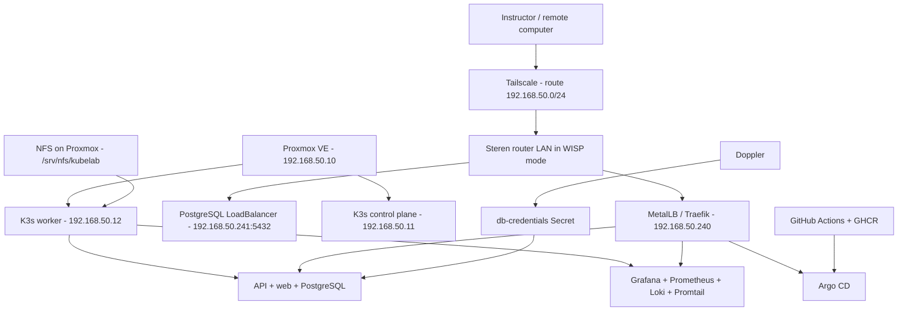

Virtual-machine, component, and storage details are documented in [docs/infraestructura/cluster-k3s.md](docs/infraestructura/cluster-k3s.md). The architecture diagram and design decisions are further explained in [docs/arquitectura/README.md](docs/arquitectura/README.md).

## 3. Laboratory inventory

| Resource | IP address | Role | Reference configuration |
|---|---|---|---|
| Proxmox VE | `192.168.50.10` | Hypervisor and NFS server | Intel i5-3470S, ~15 GiB RAM, 1 TB HDD |
| `kube-cp01` (VM 100) | `192.168.50.11` | K3s control plane | 1 vCPU, 3 GiB RAM, 32 GiB disk |
| `kuberworker01` (VM 101) | `192.168.50.12` | Active worker | 1 vCPU, 4 GiB RAM, 32 GiB disk |
| `kuberworker02` (VM 102) | `192.168.50.13` | Created VM; powered off in the final setup | 1 vCPU, ~2 GiB RAM, 32 GiB disk |
| `kuberworker03` (VM 103) | `192.168.50.14` | Created VM; powered off in the final setup | 1 vCPU, ~2 GiB RAM, 32 GiB disk |
| Steren COM-890+ | `192.168.50.1` | WISP / LAN gateway | Subnet `192.168.50.0/24` |

Four VMs were created for the laboratory. **The demonstration configuration runs a control plane and one worker** because of hardware limitations; this adjustment was agreed upon with the instructor. Destructive node-failure tests are not performed on this machine. Check the actual VM allocations in Proxmox before reproducing the laboratory.

Reference software: **Proxmox VE 9.2.2**, Ubuntu Server **26.04.1 LTS**, and **K3s v1.36.5+k3s1**. MetalLB reserves `192.168.50.240-192.168.50.249` with `autoAssign: false`.

## 4. Services and URLs for evaluation

The instructor must connect to **Tailscale** and have access to the `192.168.50.0/24` subnet. Hostnames are configured using [docs/hosts.txt](docs/hosts.txt); **the hosts file does not provide network connectivity on its own**. Setup instructions are available in [docs/vpn.md](docs/vpn.md).

| URL / address | Service | Expected result |
|---|---|---|
| `http://app.grupo5.lab/` | React web app | Product catalog and product form |
| `http://api.grupo5.lab/health` | FastAPI API | HTTP 200 and health status |
| `http://api.grupo5.lab/products` | CRUD API | JSON product list |
| `http://api.grupo5.lab/metrics` | API | Prometheus metrics |
| `http://grafana.grupo5.lab/login` | Grafana | Login page and dashboards |
| `http://prometheus.grupo5.lab/-/ready` | Prometheus | HTTP 200 |
| `https://argocd.grupo5.lab/` | Argo CD | HTTPS login (internal/untrusted certificate on some clients) |
| `192.168.50.241:5432` (`db.grupo5.lab:5432`) | PostgreSQL | SQL client connection using read-only credentials shared privately |

**Testing without DNS:** a computer with LAN/VPN access can use `curl --resolve` as demonstrated in [docs/vpn.md](docs/vpn.md). The Argo CD HTTPS route also retains `argocd.local` for compatibility. **Do not rely on `localhost` or `port-forward` for the instructor's remote verification.**

## 5. Monorepo layout

```text
apps/api/               # FastAPI, tests, Dockerfile, and schema
apps/web/               # React, components, Dockerfile, and Nginx
k8s/apps/               # Deployments, StatefulSet, Services, HPA, PDB, Job
k8s/platform/           # MetalLB, Traefik, and Doppler
k8s/observability/      # Prometheus, Loki, Promtail, Grafana, dashboards
k8s/argocd/             # API, web, database, and observability Applications
argocd/root-app.yaml    # Root Application (app-of-apps)
.github/workflows/      # API and web CI/CD pipelines
scripts/smoke-check.sh  # HTTP smoke tests
docs/                   # Access, infrastructure, screenshots, and evidence
```

## 6. Environment installation and recovery

> The following describes the **reconstruction order** and the exact configuration files. Do not run these installation steps on the stable cluster during the live demonstration. Administrator access to the hypervisor, network, and private credentials is required. Some components, including Proxmox, K3s, NFS, Argo CD, and initial CRDs, require bootstrap installation before GitOps can take over.

1. **Proxmox and networking.** Install Proxmox VE on the physical machine. Configure `vmbr0` as `192.168.50.10/24`, with gateway `192.168.50.1`. On the Steren router in WISP mode, create the `192.168.50.0/24` LAN, assign static IPs `.11`–`.14` to the nodes, and reserve `.240`–`.249` outside the DHCP pool.
2. **Virtual machines.** Create four Ubuntu Server 26.04.1 LTS VMs, one per node, with a 32 GiB disk each. Bridge their networking to the LAN and configure the IP addresses in the inventory table. Allocate RAM/CPU according to available resources; see the [VM and cluster guide](docs/infraestructura/cluster-k3s.md).
3. **K3s.** Install the K3s server on `kube-cp01` with ServiceLB disabled and Traefik enabled. Join agents with `K3S_URL=https://192.168.50.11:6443` and the server's private token. Configure workload scheduling to keep application workloads off the control plane. Never commit the token.
4. **Storage.** Export `/srv/nfs/kubelab` from Proxmox to the node IPs and deploy NFS Subdir External Provisioner with the `nfs-client` StorageClass. Reference configuration: `k8s/argocd/nfs-subdir-external-provisioner.yaml`. Verify mounts and PVCs before proceeding.
5. **MetalLB and Traefik.** Install the MetalLB controllers and CRDs, then apply `k8s/platform/metallb/`. Once the Traefik CRDs are available, apply `k8s/platform/traefik/`. Confirm the Traefik LoadBalancer receives `192.168.50.240`.
6. **Doppler.** Install the operator using `k8s/platform/doppler/helmchart.yaml`. Create the `doppler-token-secret` token Secret in `doppler-operator-system` **through a private, controlled process**, then apply `k8s/platform/doppler/db-credentials.yaml`. Confirm that the `db-credentials` Secret exists in `kubelab-dev` without printing its contents.
7. **Argo CD.** Install `argo-cd` chart version `10.11.7` with `k8s/argocd/argocd-values.yaml`. Once the cluster, repository, and CRDs are available, create `argocd/root-app.yaml`; child Applications are declared under `k8s/argocd/`. Review changes before enabling resource deletion or `prune`.
8. **Applications and observability.** API, web, PostgreSQL, Prometheus, Grafana, Loki, and Promtail are declared under `k8s/`. Their manifests are the reproducible source of configuration. External PostgreSQL access is defined in `k8s/apps/database/external-service.yaml`.
9. **Verification.** Check resources and URLs using the commands below, inspect the GHCR images, and verify the Argo CD Applications.

Verification commands on `kube-cp01`:

```bash
K="sudo kubectl --kubeconfig=/etc/rancher/k3s/k3s.yaml"
$K get nodes -o wide
$K get deployments,statefulsets,pods -n kubelab-dev
$K get deployments -n kubelab-monitoring
$K get pvc -A
$K get svc -A | grep -E 'traefik|postgres-external'
$K get ingressroute -A
$K get applications -n argocd
curl -sS -H 'Host: api.grupo5.lab' http://192.168.50.240/health
```

From the repository root in WSL, run `bash scripts/smoke-check.sh` (requires connectivity to `192.168.50.240`).

**GitOps status at the last verified checkpoint:** `kubelab-api`, `kubelab-database`, `kubelab-web`, and `kubelab-observability` were `Synced/Healthy`. The `kubelab-root` Application remained `OutOfSync/Healthy` due to manifest differences that should be reviewed before synchronization. Avoid forced sync or `prune` without inspecting the Diff.

## 7. Data, persistence, and observability

- PostgreSQL runs as a **StatefulSet**, with an NFS-backed volume provided by `nfs-client`. Schema initialization is declared in `k8s/apps/database/init-job.yaml`.
- Grafana uses the NFS PVC `kubelab-grafana-nfs`. Prometheus uses `kubelab-prometheus-single` and Loki uses `kubelab-loki-single`, both on `local-path` storage on the active worker. These StorageClass differences are documented; they are not all claimed to use NFS.
- Prometheus scrapes the API Service's `/metrics` endpoint. The query `up{job="kubelab-api"}=1` was verified.
- Promtail sends logs to Loki; real API and web logs were retrieved with `{namespace="kubelab-dev"}`.
- Grafana provisions Prometheus and Loki data sources, as well as version-controlled dashboards stored under `k8s/observability/grafana/dashboards/`.
- HPA and PDB manifests for the API and web are under `k8s/apps/`. Both applications were verified with `2/2` replicas; an unperformed load-scaling test is not claimed as completed.

## 8. CI/CD, GitOps, and security

- `.github/workflows/api.yml`: installs dependencies, runs `pytest`, publishes the API image to GHCR with a commit SHA tag, and updates the Kustomize image tag.
- `.github/workflows/web-ghcr.yml`: builds and publishes the frontend, then updates the versioned image reference in `k8s/apps/web/deployment.yaml`.
- Both pipelines have recorded successful runs; see [docs/ci-cd.md](docs/ci-cd.md) for evidence and further details.
- A `DopplerSecret` manages `DB_USER`, `DB_PASSWORD`, and `DATABASE_URL`, creating `db-credentials` for the API and PostgreSQL. The operator access token and credentials are never published in this repository.
- The current workflows use `GITHUB_TOKEN` for GHCR/GitHub; **an unverified CI integration with Doppler is not presented as completed**.

Repository changes are submitted through pull requests to the integration branch and ultimately to `main`. The instructor must receive repository access and **read-only credentials through a private channel**, never through commits or public screenshots.

## 9. Evidence

| Evidence | File |
|---|---|
| Proxmox and VMs | 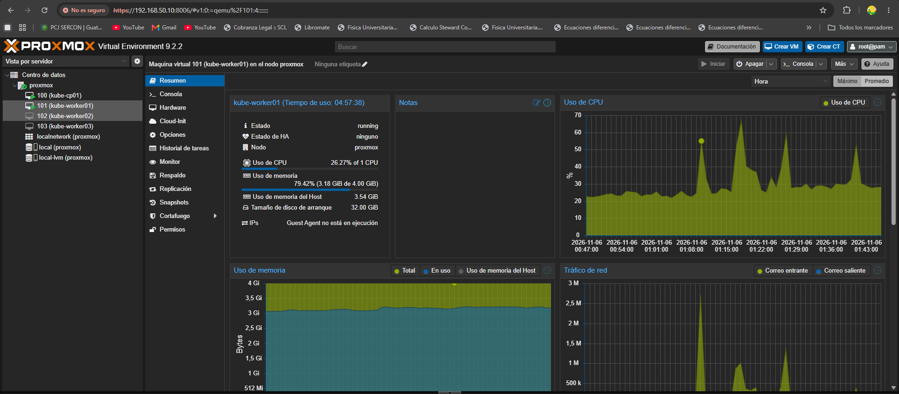 |
| K3s nodes | 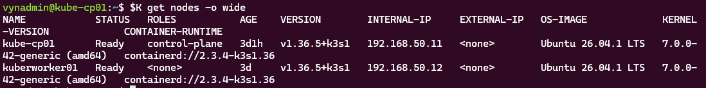 |
| API, web, and database | 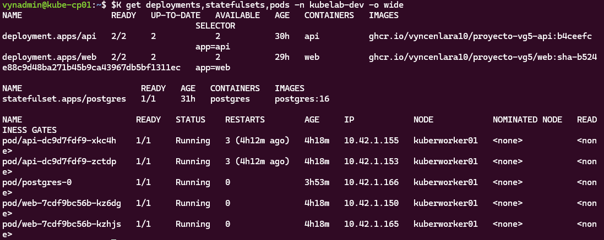 |
| Argo CD | 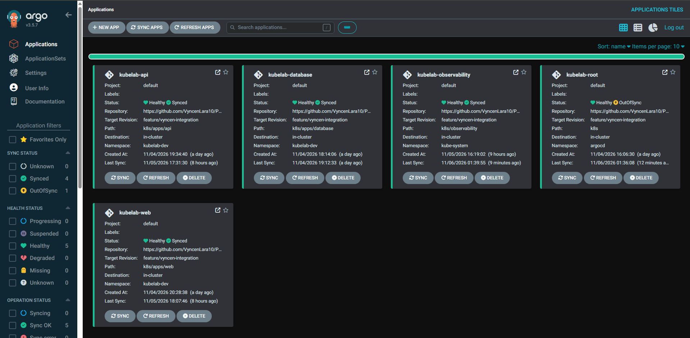 |
| Prometheus | 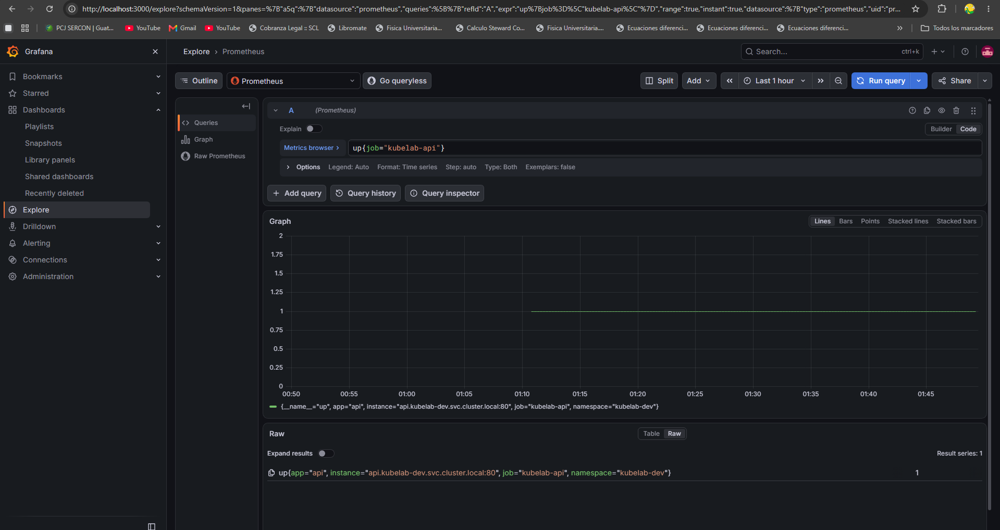 |
| Loki | 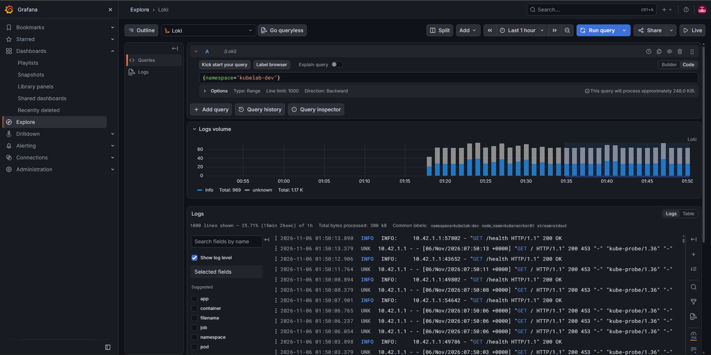 |
| Grafana: API and infrastructure | 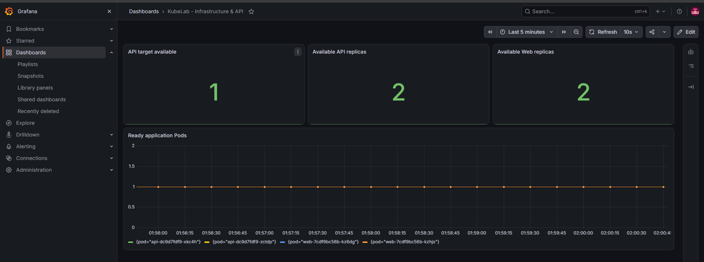 |
| Grafana: application logs | 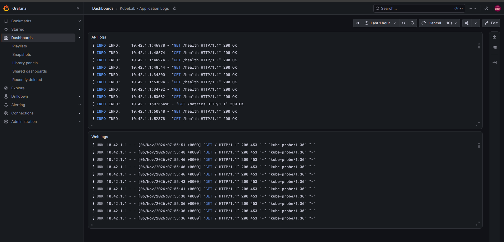 |
| Volumes | 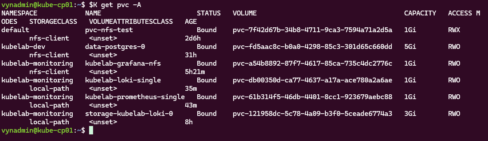 |
| GitOps on GitHub | 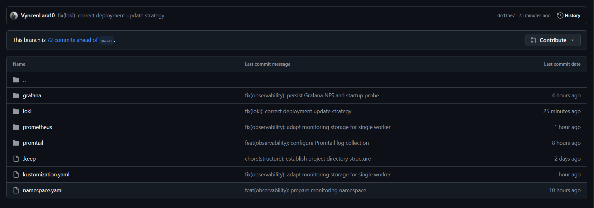 |
| Argo CD statuses | 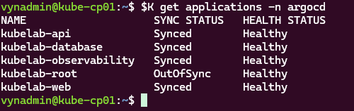 |
| Remote Tailscale access | 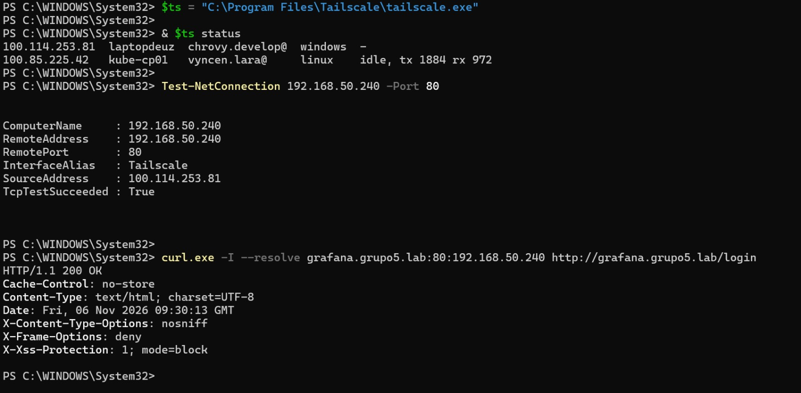 |
| API/database persistence | 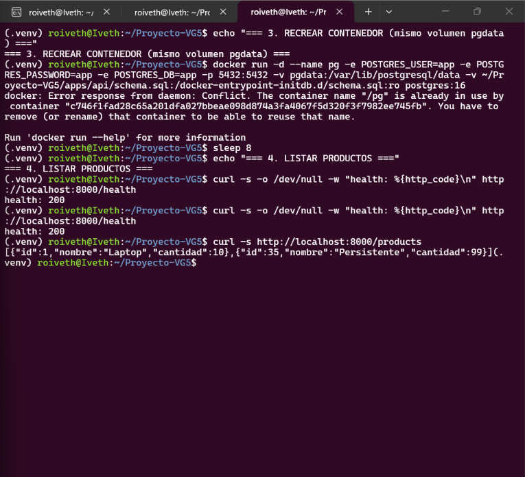 |

Detailed CI/CD evidence: [docs/ci-cd.md](docs/ci-cd.md). Screenshots reflect the laboratory status when captured and do not replace live verification.

## 10. Documentation

- [Infrastructure and nodes](docs/infraestructura/cluster-k3s.md)
- [Architecture](docs/arquitectura/README.md)
- [Tailscale, hostnames, and remote testing](docs/vpn.md)
- [Instructor access and read-only accounts](docs/acceso-docente.md)
- [CI/CD and tests](docs/ci-cd.md)
- [AI usage disclosure](docs/ia.md)

**Note:** Remote access was verified from a computer connected through mobile data and Tailscale, with port 80 on `192.168.50.240` reachable and an HTTP 200 response from Grafana. The SQL endpoint at `192.168.50.241:5432` also returned `TcpTestSucceeded: True`. These tests confirm network connectivity; each instructor account's ability to log in must be verified separately.
