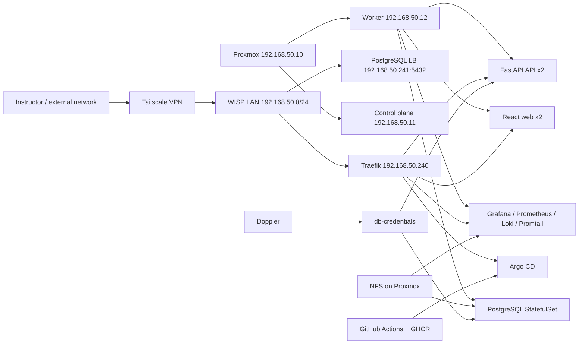

# KubeLab Architecture — Group 5

## Physical and logical design

## Key design decisions

1. **Proxmox** separates the hypervisor from the virtual Kubernetes nodes. VM network interfaces connect to the private network of the Steren router operating in WISP mode.
2. **K3s** provides a Kubernetes control plane and application hosts on resource-constrained hardware.
3. **MetalLB** advertises LoadBalancer IPs on the LAN, while **Traefik** routes requests according to the hostname and protocol. Address `.240` is reserved for HTTP/HTTPS services and `.241` for direct PostgreSQL access, without exposing these services to the Internet through router port forwarding.
4. **Argo CD** reads GitOps manifests from the integration repository branch. Application changes are built and published with GitHub Actions and GHCR.
5. **Doppler Operator** supplies a Kubernetes Secret containing database credentials. The operator token is not committed to Git.
6. **NFS** provides persistent storage for PostgreSQL and Grafana. Prometheus and Loki use `local-path` PVCs in the stable laboratory setup, providing worker-local persistent volumes.
7. **Prometheus** scrapes metrics, **Promtail** forwards logs to **Loki**, and **Grafana** queries both sources through version-controlled dashboards.
8. **Tailscale** advertises the laboratory subnet for remote evaluation. A `hosts.txt` file provides hostname resolution without deploying a dedicated DNS server.

## Limitations and considerations

- The original design includes four VMs, while the final demonstration runs the control plane and one worker due to physical resource constraints, as authorized by the instructor.
- A full worker-failure test or a successful HPA load test must not be assumed merely because the corresponding manifests exist.
- An accessible HTTP URL or TCP port does not, by itself, demonstrate that read-only account permissions work correctly.
- The root Argo CD Application's `OutOfSync` state requires reviewing the actual differences before any synchronization that may change resources.
