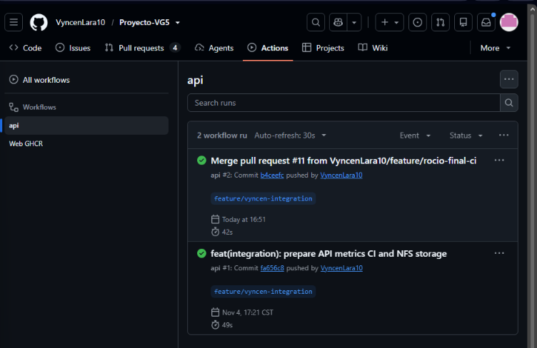
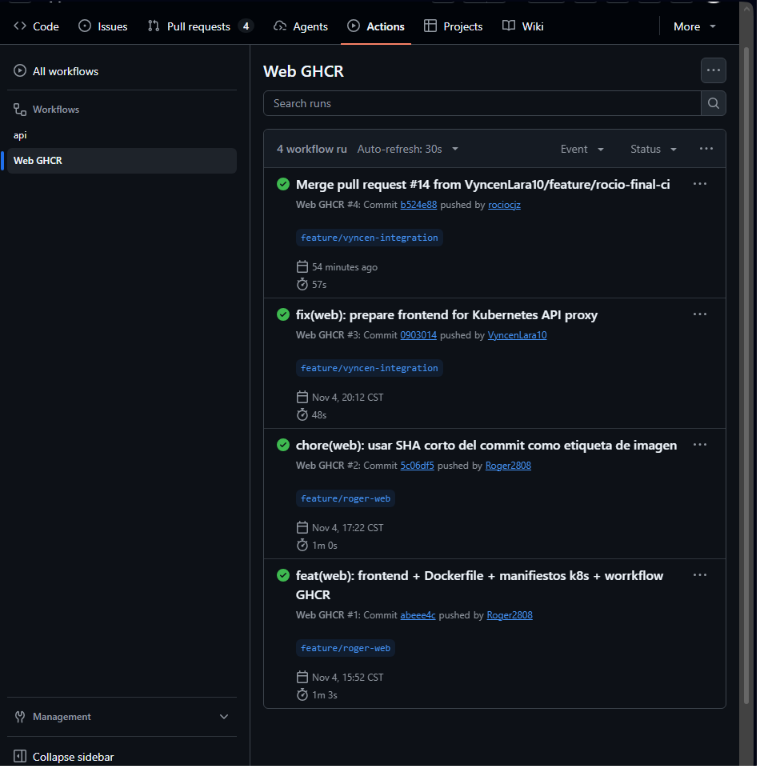
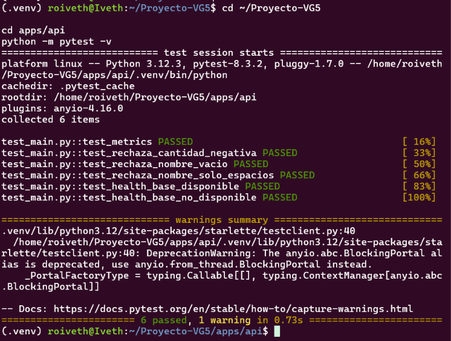
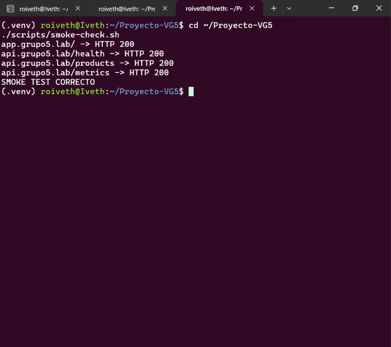
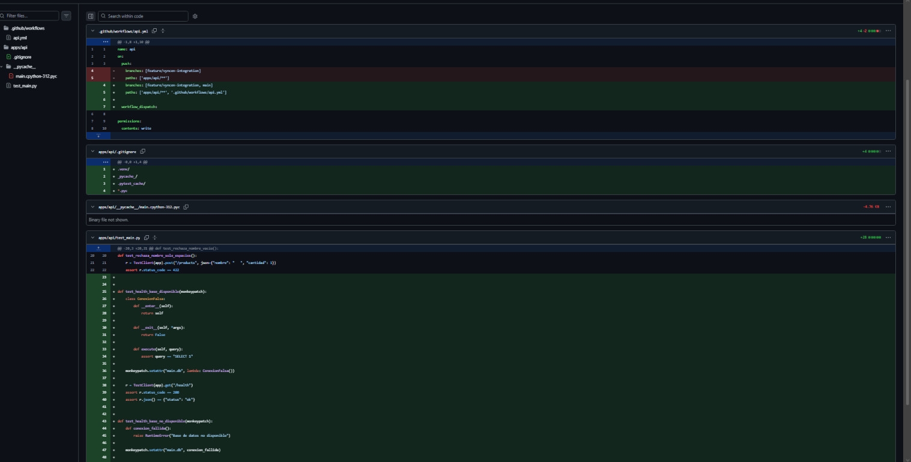
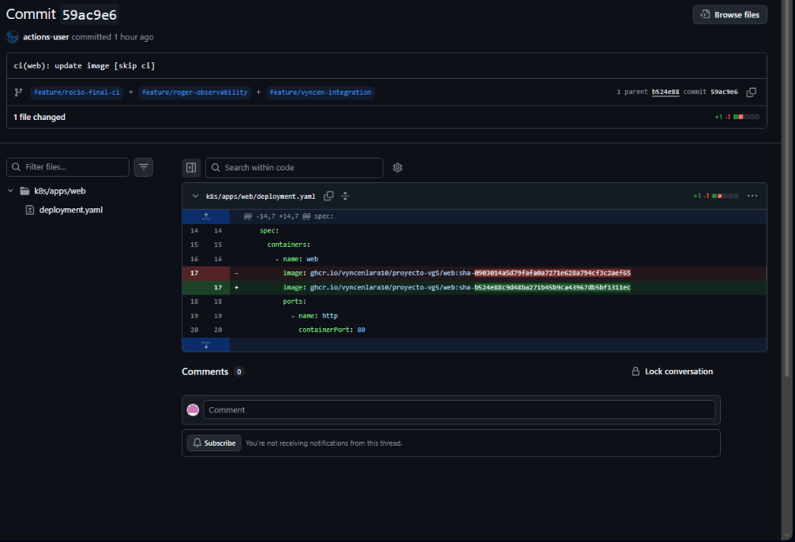

# CI/CD and Integration Testing

## API Pipeline

The API workflow is defined in `.github/workflows/api.yml`.

It performs:
- Python dependency installation
- Automated tests with pytest
- Docker image build and publication to GHCR
- Kubernetes image tag update in Git

The API pipeline generated commit `94f9f2f`, updating the image tag to `b4ceefc`.

The new API image was deployed through Argo CD and verified with two running replicas.

## Web Pipeline

The frontend workflow is defined in `.github/workflows/web-ghcr.yml`.

It performs:
- Docker image build
- Publication to GHCR
- Automatic GitOps manifest update

The workflow generated commit `59ac9e6`, updating the frontend image reference.

## Automated Tests

Six API tests passed using pytest.

The smoke test is located at `scripts/smoke-check.sh`.

Verified endpoints:
- Frontend `/` — HTTP 200
- API `/health` — HTTP 200
- API `/products` — HTTP 200
- API `/metrics` — HTTP 200

## GitOps Deployment

Argo CD manages application deployments from the repository.

Image updates are committed automatically to Git.
Deployment synchronization is performed through Argo CD.

## Evidence

Screenshots of successful GitHub Actions executions, pytest
results, and HTTP smoke checks should be included in `docs/`.

## CI/CD Evidence

### 1. API GitHub Actions

### 2. Web GitHub Actions

### 3. Automated API Tests

### 4. Integration Smoke Test

### 5. API GitOps Image Update

### 6. Web GitOps Image Update

